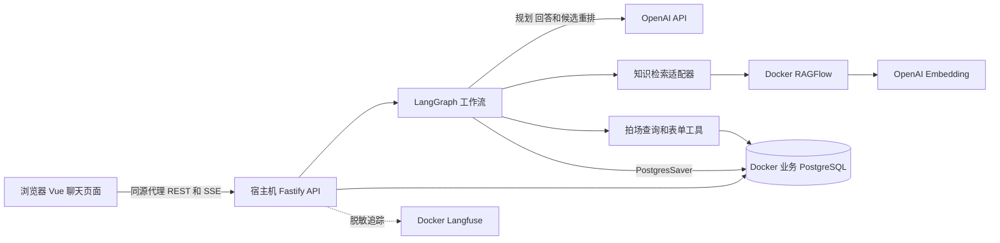

# 嘉德智能客服 Agent 本地架构

文档版本：5。更新日期：2026-11-26。关联 DEC-001 至 DEC-006、TASK-005 r1。

按用户提供的中国嘉德智能客服场景，建设可在个人 Windows 电脑演示、调试和验收的系统，覆盖 FDE 的需求拆解、系统集成、Agent 编排及交付说明。以下为实现目标，不表示已接入中国嘉德生产系统或已完成所述项目经历。

## 当前实现与设计边界

已有协作文档、环境模板、根 Compose、业务 PostgreSQL/RAGFlow 本地配置、Langfuse 覆盖配置及准备脚本；已具备 pnpm workspace、Vue/Vite 基础页面、Vue Router/Pinia 注册、Fastify `/health/live`、共享契约及工程检查配置。Docker 引擎可用；TASK-005 将 PG/RAGFlow 持久数据绑定到项目 `data/`，配置及目录检查通过，但尚未启动业务容器。客服业务、身份识别、数据库表/迁移和外部服务集成尚未实现。依赖及启动说明见 [前后端开发环境](development-toolchain.md)、[Docker 配置](docker-local.md)，验证状态见 result.md。

用户指定 TypeScript、Node.js、Fastify、LangGraph、RAGFlow、PostgreSQL、Langfuse、Docker。数据库和 RAGFlow 运行在 Docker Desktop；前后端和自有容器配置集中在本仓库。模型通过 OpenAI API 调用，密钥稍后配置。

工程采用 Vue 3 + Vite、pnpm workspace、Zod、Drizzle、Vitest 和 Playwright，TASK-003 已开始将相应基础配置落地。Drizzle 当前只有 schema 配置，运行表和所有业务表仍待实现。初版方案保持单 API 进程与持久化运行表，不增加独立消息队列或多 Agent 自主协作。

## 本地拓扑

前端和 API 在 Windows 宿主机热更新，Docker Desktop 使用 WSL2 Linux containers。根 Compose 项目 gard-local 组合业务 PostgreSQL 19.0 和 RAGFlow v1.0.0，但两者使用独立网络及数据库；PG/RAGFlow 镜像按本机下载摘要固定，运行数据绑定到 G:/Agent-Demo/data 并被 Git 忽略（DEC-006）。RAGFlow 的五个内部依赖不发布宿主端口。Langfuse 保持独立 Compose 项目，本轮未调整其存储。后续完整容器演示再为自有前后端增加 Dockerfile 和应用 Compose。

| 服务 | 宿主地址 | 职责 |
| --- | --- | --- |
| Vue/Vite | `127.0.0.1:5173` | 会话、消息、引用、拍场卡片、表单草稿与确认 |
| Fastify | `127.0.0.1:3001` | REST/SSE、访问者识别、运行调度 |
| 业务 PostgreSQL | `127.0.0.1:5433` | 消息、草稿、拍场、回执、检查点 |
| RAGFlow | `127.0.0.1:8080` | 知识库管理、检索 |
| Langfuse | `127.0.0.1:3000` | 模型和工具追踪 |
| Langfuse 对象服务 | `127.0.0.1:9090` | 自托管附件接口 |

RAGFlow 默认 CPU 路径附带 Elasticsearch、MySQL、对象存储、Kvrocks 和 NATS；业务 PostgreSQL 不替代它们。Langfuse 使用独立 PostgreSQL、ClickHouse、Redis、对象存储及 web/worker；本地覆盖配置默认不启动其 AI Gateway。版本与依据见 [官方资料](sources.md)。

## 业务范围

1. 须知问答：检索已审核的演示资料，附来源、版本和生效日期；证据不足时说明无法确定。
2. 拍场查询与推荐：查询虚构场次的城市、类别、时间和状态。程序过滤排序，模型解释理由；实时档期不从知识库回答。
3. 对话表单：初版实现“参拍咨询预约”，字段为称呼、联系方式、感兴趣的拍场、咨询内容及联系同意。完整后展示摘要，明确确认才提交。不是正式竞买登记，不处理身份证、支付或竞价。
4. 多问题：将一条消息拆成有依赖的子任务，执行问答、查询，等待必要信息后继续表单。
5. 历史与恢复：刷新、关闭页面、API 重启后保留消息和草稿，在已保存的流程边界继续执行。

首版不接真实客户数据或官网业务系统。拍场和咨询提交采用本地数据库实现，保留适配器以便未来对接。

## 代码模块

| 目录 | 计划职责 |
| --- | --- |
| `apps/web/src/` | 会话页、SSE 客户端、引用与表单组件 |
| `apps/api/src/routes/` | 会话、消息、事件、恢复及健康接口 |
| `apps/api/src/agent/` | 图、状态、规划器、节点和恢复 |
| `apps/api/src/tools/` | 知识检索、拍场查询、咨询提交 |
| `apps/api/src/adapters/` | OpenAI、RAGFlow、Langfuse、业务接口 |
| `apps/api/src/db/` 和 `drizzle/` | 业务 schema、仓储、迁移与种子 |
| `packages/contracts/` | API、SSE、工具与状态共享 schema |
| `knowledge/`、`evals/` | 演示文档、来源清单、固定问题及结果 |
| `infra/`、`scripts/` | 配置、上游版本及准备脚本 |

未创建的目录在对应实施阶段建立，目录规划不表示代码已经存在。

## Agent 工作流

输入鉴权 → 结构化拆解 → 程序校验任务依赖 DAG → 调度就绪任务 → 工具调用或表单追问 → 汇总回答和引用。

规划输出包含 `taskId`、`type`、`dependsOn`、`arguments`。任务类型限知识问答、拍场查询、咨询收集；最多 5 个，依赖有效且无环。规划失败最多修正一次，仍失败则澄清。初版按拓扑顺序串行执行。

每次运行最多 8 次工具调用，含重试；只读工具默认超时 15 秒，模型 60 秒。可恢复网络错误最多退避重试一次；鉴权、余额不足、无效参数、业务拒绝不循环重试。运行总预算、图递归上限和取消检查由程序执行。

模型只产生允许工具的结构化参数，不执行任意 SQL、URL、脚本或 shell。资料中的指令不能改变工具权限。工具再次校验日期、字段长度、拍场有效性和访问者归属。

## 数据与一致性

业务表使用 `app` schema；检查点使用 `workflow` schema，由 PostgresSaver 初始化维护，Drizzle 不管理其内部表。业务事务和检查点保存不是同一个原子事务。

| 表 | 字段和约束重点 |
| --- | --- |
| `visitors`、`visitor_sessions` | 服务端访问者、令牌摘要、过期时间 |
| `conversations` | `id`、`owner_id`、标题、时间 |
| `messages` | 会话、角色、内容、引用；用户请求按同会话 client_message_id 去重，最终回答按 run_id/output_kind 唯一 |
| `workflow_runs` | 归属会话、状态、图版本、租约、错误；运行 ID 即 graph thread ID |
| `run_events` | 事件及载荷；`(run_id, seq)` 唯一 |
| `form_drafts` | 归属、结构化字段、缺项、版本、确认版本、状态 |
| `consultations` | `draft_id` 唯一、回执、提交时间 |
| `idempotency_requests` | 归属、操作、稳定 key、请求摘要、完整结果；唯一约束 |
| `auctions` | 虚构场次、类别、地点、起止时间、状态、更新时间 |
| `knowledge_sources` | 文档 ID、来源 URL、标题、版本、生效/失效时间和审核状态 |

时间存 UTC、显示 Asia/Shanghai；“下周”先转换成明确日期范围，不足则追问。

提交幂等键基于持久化 `draft_id`，不在每次重试时重新生成。用户确认绑定草稿版本，字段改动撤销旧确认。提交时锁定草稿并校验归属、版本及确认状态，在一个事务内保存咨询、回执、幂等结果。同 key 同请求返回原回执，不同摘要返回 409；咨询表的唯一约束防止并发重复。

提交已入库而检查点未保存时崩溃，重放仍返回原回执。未来接外部提交 API，必须使用对方幂等能力或 outbox 与对账机制；不能依赖检查点保证外部副作用只发生一次。

## 暂停 恢复和插问

使用 `@langchain/langgraph-checkpoint-postgres`，缺项或确认节点通过 `interrupt()` 暂停，同一 thread ID 配合 `Command({ resume: ... })` 恢复。节点恢复会重入，读取输入、确认、提交拆成独立节点，写操作幂等。[官方恢复规则](https://docs.langchain.com/oss/javascript/langgraph/interrupts)

每个会话可有多条工作流，初版最多一个待完成表单。表单暂停期间插问须知，创建另一个只读工作流，保留原运行和草稿；回答后提示继续。明确继续才恢复原流程。无法区分补字段、修改、取消和新问题时追问，不将所有消息直接传给 resume。

每个会话同时只执行一个改写状态的运行，使用数据库租约及唯一约束。恢复前取得执行权并核验归属、运行状态、interrupt ID、草稿版本；重复恢复请求去重。API 启动扫描租约过期的运行，按检查点恢复。暂停的表单不占执行租约；取消停止后续调度，已提交业务不可假装撤回。

## API 和 SSE

| 方法及路径 | 行为 |
| --- | --- |
| `POST /api/visitor-session` | 本地匿名访问者，设置 HttpOnly cookie |
| `POST /api/conversations`、`GET /api/conversations` | 创建及列出自己的会话 |
| `GET /api/conversations/:id/messages` | 分页读取自己的历史 |
| `POST /api/conversations/:id/messages` | 接收 clientMessageId、文本，持久化后返回 202 与 runId |
| `GET /api/runs/:id/events` | SSE，支持 Last-Event-ID 及 after 游标 |
| `GET /api/runs/:id` | 状态、草稿与最后事件序号 |
| `POST /api/runs/:id/resume` | 请求 ID、interrupt ID、草稿版本和输入 |
| `POST /api/runs/:id/cancel` | 停止后续执行 |
| `GET /health/live`、`GET /health/ready` | 存活、数据库及必需配置准备状态 |

Vite 代理 `/api`，cookie/SSE 同源。cookie 由服务端签发，HttpOnly、SameSite=Lax，写接口校验 Origin；开发监听 loopback。所有会话、事件、草稿、恢复和提交入口验证归属。匿名 cookie 仅适合单机演示，不代表正式用户身份；前端传 userId 不能改变归属。

事件含 id、runId、seq、type、时间和载荷，类型包括 `run.started`、`task.started`、`answer.delta`、`source`、`form.updated`、`run.waiting_input`、`run.completed`、`run.failed`。重要事件先保存再发送；文本增量批量保存，最终回答另存消息。前端序号去重，断线补发；游标过期则重取消息和状态。约 15 秒心跳；浏览器断线不自动取消后台运行。

## RAGFlow 检索与重排

只接检索接口，不用 RAGFlow 的 Agent 再编排一遍业务。封装 `POST /api/v1/retrieval`，核验 HTTP 状态及 JSON code，将片段归一化成内容、文档 ID、标题、URL、版本、生效时间和得分。URL 由维护的来源清单补全，不假定检索结果自带公开链接。

小型中文 Markdown/TXT 起步，按主题和版本分文档，导入后检查解析、切片及元数据。过期版本禁用并重建索引；错误召回用类别、版本和阈值过滤；无有效证据则澄清。引用只能来自本次有效检索。实时档期和状态始终查询业务工具。

Chat 与 Embedding 分别配置。第一版采用 RAGFlow 混合召回 + Fastify 应用层 OpenAI 重排：最多返回 10 个候选片段，模型以结构化输出给出候选 ID 顺序及相关性，程序校验 ID 属于候选集、去重并取前 5 个，保留原文和引用。超时或无效输出退回原检索排序并记录降级，不编造片段。它增加模型调用成本，必须做开启前后的检索对照测试。

这与用户描述中“在 RAGFlow 内配置重排”的位置存在差异：当前只有 OpenAI Key，不能假定 RAGFlow 镜像自带 reranker 或 OpenAI 提供兼容的 rerank endpoint。第一版 `RAGFLOW_RERANK_ID` 留空，`RERANK_MODE=openai`；原生 RAGFlow + CPU TEI/provider 重排作为后续兼容性验证项，成功后再切换。不能把应用层重排写成已完成 RAGFlow 原生重排。此项是本轮方案说明，不替用户宣称已有能力。

## 观测与验收

Langfuse 使用 conversationId 关联 session、runId 关联 trace，记录规划、检索、工具、模型耗时、token 和错误。屏蔽密钥、cookie、联系方式和敏感表单字段。导出失败不阻断客服，限量重试并报告观测异常。开发前期可关闭 Langfuse；完整验收需实际 trace。

真实验收覆盖模型调用、RAGFlow 检索、业务查询、表单提交、进程重启恢复、重复提交、SSE 重连及两位访问者隔离。Mock 只用于故障测试，不替代真实依赖验收。详见 [实施计划](implementation-plan.md)。
